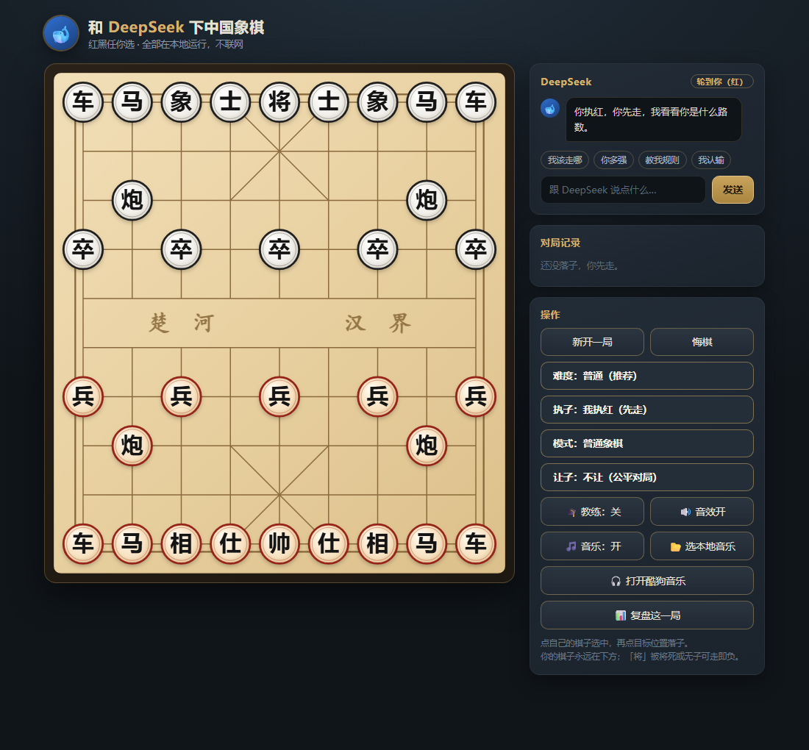
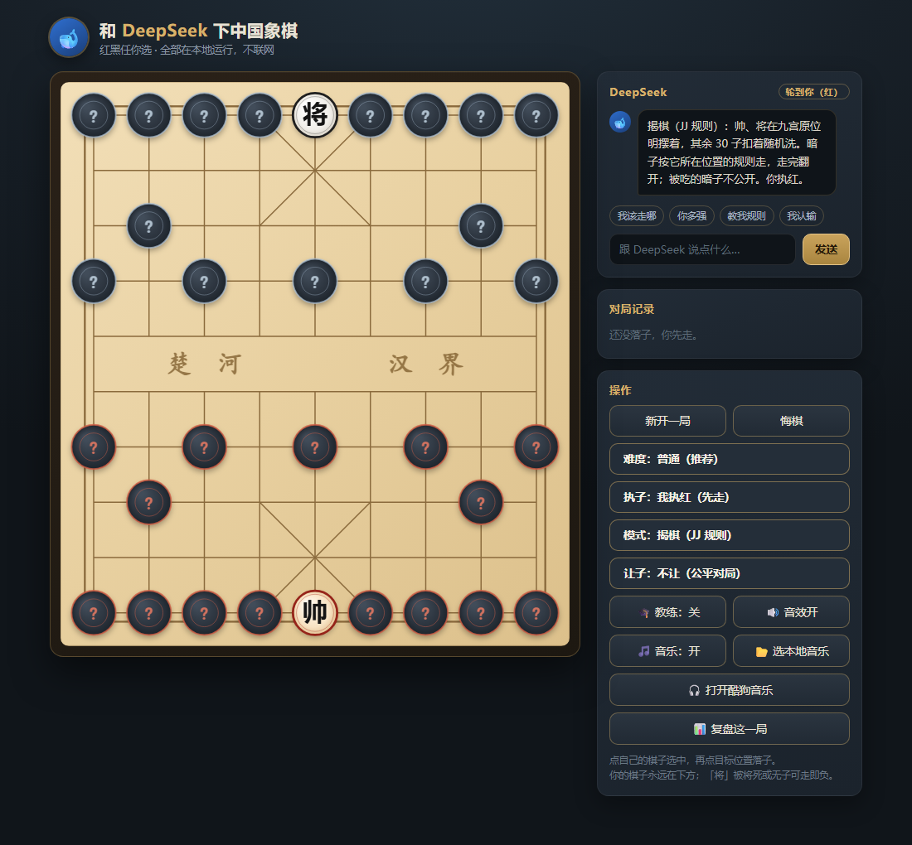

# dsh-xiangqi

中国象棋 / 揭棋，作为 **DeepSeek Harness Web** 的整页面板插件。
Chinese chess (xiangqi) and jieqi for DeepSeek Harness Web, as a full-page panel.



---

## 中文

### 这是什么

一个装进 DSH 侧栏的象棋面板。点侧栏的「象」入口，整页打开对局界面。
游戏本体是一份自包含的 HTML 文档（引擎、渲染、音效、聊天全在里面），
插件层只负责把它挂进 DSH 的插槽，因此不依赖任何后端服务、不联网、断网可玩。

### 功能

| | |
|---|---|
| 对局 | 普通象棋；可选执红（先手）或执黑（后手，棋盘自动翻转） |
| 引擎 | alpha-beta + 静止搜索（吃子延伸到底）；简单 3 层 / 普通 4 层 / 困难 6 层，带限时兜底 |
| 开局库 | 6 条常见定式（中炮屏风马、顺炮、仙人指路、飞相局、进 7 卒、起马局） |
| 揭棋 | JJ 规则：将帅明置原位，暗子按所在位置兵种走、走完翻开，被吃暗子不公开身份 |
| 教练模式 | 每手给出分值变化，明显亏损时提示更好的走法 |
| 让子 | 让一马 / 双马 / 一车 |
| 复盘 | 整盘优劣势曲线，标出你亏得最狠的几手 |
| 音效 | 落子、吃子、将军、胜负、翻子，全部 Web Audio 实时合成，无音频文件 |
| 背景音乐 | 内置五声音阶合成乐；也可以选本地音乐文件循环播放 |
| 聊天 | 本地规则应答，带棋局上下文，不联网 |



### 安装

```bash
dsh plugin --profile web add dsh-xiangqi
```

重启 `dsh web` 后，侧栏面板列表会出现「象」入口。

本地开发可直接 link 目录：

```bash
dsh plugin --profile web add /path/to/dsh-xiangqi
```

### 卸载

```bash
dsh plugin --profile web remove dsh-xiangqi
```

若 profile 的 `dsh.profile.bundles` 里仍留有 `dsh-xiangqi`，一并删除后在 profile 目录重新 `pnpm install`。

### 结构

```
package.json        dsh 清单：bundle.patch / client.inject / platform
cordis.patch.yml    向 web 插件名册插入一行 { id: ui-xiangqi, name: dsh-xiangqi }
lib/index.js        宿主端入口（空实现，不注册服务）
lib/client.js       客户端模块：注册 sidebar.panellist 入口 + main 页面
assets/             README 截图
```

客户端模块按 DSH 的模块格式交付：

```js
window.__ModuleLoader__.load({ id: "dsh-xiangqi", factory: (require) => { ... } });
```

`factory` 只依赖 `react`，导出 `apply(ctx)` 与 `inject = ["slots"]`。
页面用 `<iframe srcDoc>` 承载游戏文档，因此与宿主界面样式隔离。

### 开发

改了游戏本体后重新生成 `lib/client.js`：把新的 HTML 读进来、
`JSON.stringify` 后替换 `GAME_HTML` 常量即可，其余代码不用动。

### 许可

MIT。无第三方素材：字体用系统自带，音效与背景乐均为代码实时合成。

---

## English

### What it is

A xiangqi (Chinese chess) panel for DeepSeek Harness Web. Click the **象** entry in the
sidebar's panel list and the board opens full-page. The game itself is one
self-contained HTML document (engine, rendering, audio and chat included); the plugin
layer only mounts it into a DSH slot, so there is no backend, no network, and it works
offline.

### Features

- **Play**: classic xiangqi; play red (first) or black (second, board auto-flips)
- **Engine**: alpha-beta with quiescence search; depth 3 / 4 / 6 by difficulty, time-capped
- **Opening book**: six common lines (central cannon vs screen horses, same-direction
  cannon, pawn opening, elephant opening, and more)
- **Jieqi (revealed chess)**: generals face-up in place; hidden pieces move by the rule of
  the square they stand on and flip after moving; captured hidden pieces stay secret
- **Coach mode**: scores each of your moves and suggests a better one when you lose material
- **Handicap**, **review curve**, **synthesized SFX**, **generated background music**,
  **optional local music file**, and an **offline chat** that knows the position

### Install

```bash
dsh plugin --profile web add dsh-xiangqi
```

Restart `dsh web`; the **象** entry appears in the sidebar panel list.

### Uninstall

```bash
dsh plugin --profile web remove dsh-xiangqi
```

Remove the leftover `dsh-xiangqi` entry from `dsh.profile.bundles` if present, then run
`pnpm install` in the profile directory.

### License

MIT. No third-party assets: system fonts, and every sound is synthesized at runtime.

---

## 已知限制 / Known limitations

- 揭棋搜索里暗子被"试走"时引擎能看到其真实身份（严格说是偷看），未做蒙特卡洛期望。
  搜索中 hidden pieces are peeked at when the engine tries a move — Monte-Carlo
  expectation over the reveal is not implemented yet.
- 未实现长将判负、长捉禁着、40 回合无吃子判和。
  No repetition / perpetual-check / 40-move draw rules.
- 聊天是本地规则库，不是大模型，超出脚本的话题只能兜底。
  The chat is a local rule-based responder, not an LLM.
